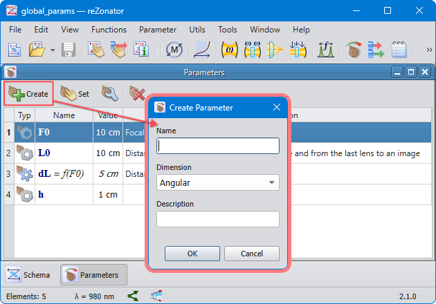

# 文档

reZonator 用户手册使用 [Sphinx 文档生成器](http://www.sphinx-doc.org) 构建。

## 准备环境

虚拟环境在不同项目部分之间共享，例如 `calc` 和 `help`，所以最好在项目顶层创建它。

在 Ubuntu 上需要 `patchelf` 软件包：

```bash
sudo apt-get install patchelf
```

Linux、macOS：

```bash
python3 -m venv .venv
source .venv/bin/activate
```

Windows（Windows 上没有 `python3` 命令，所以请确保 Python 3 在 PATH 中）：

```bash
python -m venv .venv
.venv\Scripts\activate
```

## 安装依赖

构建帮助文档只需要

```bash
python -m pip install sphinx
```

## 构建

Linux、macOS：

```bash
./make.sh
```

Windows：

```bash
make.bat
```

目标文档在 `../out` 目录中。

## 说明

### 字体

Assistant 中默认的主字体大小看起来有点小而且不好看。这取决于平台，所以最好在运行时使用 Assistant 的“视图”菜单调整字体大小，而不是在 CSS 文件中把它设得更大。样式中 body 的 `font-size` 保持不定义。至于字体，Assistant 似乎无法使用任意字体，它的缩放命令开始出现故障，不同次运行显示的字体大小甚至可能不同。所以字体大概也最好保持默认。

### 公式

由于文档包含大量物理公式，它们应该以图片形式插入。Qt Assistant 使用 `QTextDocument` 来显示帮助页面，与真正的浏览器相比功能较少。而且 Assistant 无法运行 JavaScript 代码。因此公式图片是显示它们的唯一可能方式。

使用 [render_formula.html](./render_formula.html) 页面作为简单的公式编辑器来试验 TeX 语法。[这里](../docs/latex-symbols.md) 有一份关于 TeX 符号的简短手册。公式在编辑器中完成并证明是有效的 TeX 后，可以把它粘贴到 RST 文档中，放在 `tex` 标签之后，后面跟着相应的 `image` 标签，例如：

```
Some text some text some text

  .. tex:
    \cfrac{1}{F} = (n - 1)\bigg[\, 
        \cfrac{1}{R_1} - 
        \cfrac{1}{R_2} + 
        \cfrac{(n -1)T}{n R_1 R_2}
    \bigg]\,

  .. image:: img/calc_lens_f.png

Some text some text some text
```

`tex` 不是标准标签，所以 sphinx 只把它当作注释处理。有一个 [Node.js](https://nodejs.org) 脚本读取这些标签，并使用著名的 [MathJax](https://github.com/mathjax/MathJax) 库把 TeX 语法渲染成 SVG 格式。然后脚本把每个 SVG 公式转换成 PNG 图片，并保存到 `image` 标签中指定的文件。

注意上面代码片段中的缩进很重要。`image` 标签必须缩进以成为一个单独的段落，否则图片会被内联插入。由于 `image` 缩进了，`tex` 也应该缩进，否则 `image` 会成为注释的一部分而被忽略。

使用示例：

```bash
# Download MaxJax and additional libraries
npm install

# Generate PNG images for a single file
node render_formulas.js calc_lens.rst

# Update all formula images in all files
node render_formulas.js --overwrite *

# Run against several files and show formulas (no PNG generated)
node render_formulas.js --dry-run calc_lens.rst calc_grin.rst
```

还有一些 ODF 文件是 LibreOffice Math 公式。它们应被视为已弃用，并逐步替换。原因是 Math 使用自己的语法而不是常规的 TeX，而且它渲染出的公式外观不如 MathJax 渲染的公式好看。

### 颜色

截图用色：按钮和箭头用 `#FF494F`，窗口边框用 `#FF7C7F`，例如



## RST 速查表和一些规则

完整语法见 [sphinx 文档](https://www.sphinx-doc.org/en/master/usage/restructuredtext/index.html)。

### 标题

第一级用于 `index.rst` 中列出的章节，见 `schema.rst`、`elements.rst`：

```
******
Schema
******
```

第二级用于单个主题文件，例如 `params_window.rst`：

```
Gaussian Beam Calculator
========================
```

第三级用于主题文件内部的子主题：

```
Calculation Algorithm
---------------------
```

第四级和第五级用于最内层的子主题：

```
Change waist
^^^^^^^^^^^^

Lock waist
~~~~~~~~~~
When locking waist then bla-bla-bla...

Lock front
~~~~~~~~~~
When locking front then bla-bla-bla...
```

### 索引条目

```
.. index:: single: global parameter
```

### 导航锚点

在文本中设置一个可以导航到的锚点：

```
.. _pump_mode_vector:

Ray Vector 
----------

section text bla-bla-bla...
```

这会在目标 html 中创建一个 id：

```html
<div class="section" id="ray-vector">
<span id="pump-mode-vector"></span><h2>Ray Vector</h2>
```

可以看到，章节标题也会创建一个锚点：`Ray Vector --> id="ray-vector"`。

然后可以在代码中使用它来导航到帮助主题，例如：

```cpp
QString PumpParamsDialog::helpTopic() const
{
    return "pump_mode.html#" + _params->modeName().toLower();
}
```

### 交叉引用

手动命名的锚点引用：

```
:ref:`Waist <pump_mode_waist>`
```

自动命名的文档引用：

```
:doc:`input_beam`
```

手动命名的文档引用：

```
:doc:`Input beam<input_beam>`
```

外部链接

```
This is the Lua `original documentation <https://www.lua.org/manual/5.3/>`_ for the reference.
```
